# NNUE architectures

A visual history of every network the engine has evaluated with: one
diagram per trained net, kept and dropped alike, drawn from a small manifest
of its topology and rendered to SVG by [D2](https://d2lang.com). The
diagrams show what the engine *computes*; what each net was trained on, how
it was tested and how it played stays in [nets.md](../nets.md), the ledger
every snapshot links back to.

## Reading a diagram

Every diagram draws the forward pass top to bottom, in the order
[nnue.md](../nnue.md) describes it, one colour per stage:

| Colour | Stage | What it is |
|:--|:--|:--|
| Blue | Board | bullet's `Chess768` input: one feature per colour, piece kind and square, 768 per perspective, each perspective seeing the board from its own side |
| Violet | Own-king view | with king buckets, each perspective picks one of K slices of the input weights by the bucket its *own* king stands in, mirrored left to right when that king is on files e–h ([king-buckets.md](../king-buckets.md)). Absent on single-view nets |
| Cyan | Feature transformer | two accumulators, one per perspective, both reading **the same** `768 × K → H` weights; `H` is the hidden width per perspective |
| Green | SCReLU | `clamp(x, 0, 255)²` on every pre-activation |
| Amber | Output | the `2H` activations, side to move first, into one head of `2H → 1`. With output buckets the net carries a bank of B heads and the position's piece count picks **one**; the others are not evaluated |
| Rose | Evaluation | the head's sum scaled to centipawns, from the side to move's point of view |

The caption under each diagram gives the full net id and the ledger's
notation for the topology, `(768 × K → H) × 2 → B` (`× K` omitted when K is
1), plus the parameter count and the net's status. Two nets with the same
topology get the same picture under different captions: a retrained or
relabelled net is a new snapshot, not a new architecture.

## The current default

<!-- nnue-diagrams:current:start -->
**`net8-l050-r42564788061`** — `(768 × 4 → 512) × 2 → 8` (H512 · K4 · B8), Default since v0.48.0; plays generation 7.
512 hidden neurons per perspective, 4 king buckets, 8 output heads; 1,581,576 parameters.
[Diagram source](diagrams/net8-l050-r42564788061.d2) · [manifest](manifests/net8-l050-r42564788061.json) · [the ledger's record](../nets.md#net8-l050-r42564788061)

<p align="center">
  <a href="diagrams/net8-l050-r42564788061.svg"></a>
</p>
<!-- nnue-diagrams:current:end -->

## Every net, in training order

The order is the `Train` run id in each net id. **Topology** rows are the
architecture changes; the others changed only the data, the schedule, λ or
the labels. [evolution.md](evolution.md) walks the topology changes with
their measured outcomes. Experiment numbers are Elo from the PR's SPRT
comment, both legs, as recorded in [nets.md](../nets.md).

<!-- nnue-diagrams:timeline:start -->
| # | Net | Topology | Change from the net before | Status | Experiment | Links |
|--:|:--|:--|:--|:--|:--|:--|
| 1 | `net1-l050-r41022503872` | `(768 → 128) × 2 → 1` | The first net: bullet's reference (768 → 128) × 2 → 1 SCReLU network, trained on generation 0 (PeSTO's self-play) | Retired: Default v0.28.0–v0.29.0; played generation 1 | #122 vs PeSTO: +587.3 ± 82.7 timed, +563.4 ± 93.8 at fixed nodes (kept) | [diagram](diagrams/net1-l050-r41022503872.svg) · [source](diagrams/net1-l050-r41022503872.d2) · [manifest](manifests/net1-l050-r41022503872.json) · [ledger](../nets.md#net1-l050-r41022503872) |
| 2 | `net2-l050-r41110004652` | `(768 → 128) × 2 → 1` | Data: Generation 1 (played by net 1) added to generation 0; the network is net 1's (from `net1`) | Superseded: Default v0.30.0; replaced by net2x80 before playing a generation | #129 vs net1: +112.8 ± 21.1 timed, +134.4 ± 22.7 at fixed nodes (kept) | [diagram](diagrams/net2-l050-r41110004652.svg) · [source](diagrams/net2-l050-r41110004652.d2) · [manifest](manifests/net2-l050-r41110004652.json) · [ledger](../nets.md#net2-l050-r41110004652) |
| 3 | `net2x80-l050-r41131366975` | `(768 → 128) × 2 → 1` | Schedule: 80 superbatches instead of 40, on net 2's data (from `net2`) | Retired: Default v0.31.0–v0.32.0; played generation 2 | #134 vs net2: +21.0 ± 8.9 timed, +23.5 ± 9.4 at fixed nodes (kept) | [diagram](diagrams/net2x80-l050-r41131366975.svg) · [source](diagrams/net2x80-l050-r41131366975.d2) · [manifest](manifests/net2x80-l050-r41131366975.json) · [ledger](../nets.md#net2x80-l050-r41131366975) |
| 4 | `net2x80-l025-r41141703294` | `(768 → 128) × 2 → 1` | λ: λ 0.25 instead of 0.5; everything else net2x80's (from `net2x80`) | Dropped (#137): λ 0.25 lost to net2x80 in the λ sweep | #137 vs net2x80: −38.1 ± 12.8 (H0) timed, −60.9 ± 16.7 (H0) at fixed nodes (dropped) | [diagram](diagrams/net2x80-l025-r41141703294.svg) · [source](diagrams/net2x80-l025-r41141703294.d2) · [manifest](manifests/net2x80-l025-r41141703294.json) · [ledger](../nets.md#the-λ-sweep-net2x80-at-λ-025-and-075) |
| 5 | `net2x80-l075-r41145466004` | `(768 → 128) × 2 → 1` | λ: λ 0.75 instead of 0.5; everything else net2x80's (from `net2x80`) | Dropped (#140): λ 0.75 did not beat net2x80 in the λ sweep | #140 vs net2x80: −3.2 ± 4.5 (H0) timed, −4.1 ± 4.8 (H0) at fixed nodes (dropped) | [diagram](diagrams/net2x80-l075-r41145466004.svg) · [source](diagrams/net2x80-l075-r41145466004.d2) · [manifest](manifests/net2x80-l075-r41145466004.json) · [ledger](../nets.md#the-λ-sweep-net2x80-at-λ-025-and-075) |
| 6 | `net3-l050-r41160495666` | `(768 → 128) × 2 → 1` | Data: Generation 2 (played by net2x80) added (from `net2x80`) | Superseded: Default v0.33.0–v0.34.0; replaced by net 4 before playing a generation | #145 vs net2x80: +21.8 ± 9.2 timed, +32.3 ± 11.3 at fixed nodes (kept) | [diagram](diagrams/net3-l050-r41160495666.svg) · [source](diagrams/net3-l050-r41160495666.d2) · [manifest](manifests/net3-l050-r41160495666.json) · [ledger](../nets.md#net3-l050-r41160495666) |
| 7 | `net4-l050-r41165115607` | `(768 → 256) × 2 → 1` | **Topology**: Hidden width 256 instead of 128: the first architecture change (from `net3`) | Superseded: Default v0.35.0; replaced by net4w512 before playing a generation | #150 vs net3: +74.2 ± 16.4 timed, +88.1 ± 16.4 at fixed nodes (kept) | [diagram](diagrams/net4-l050-r41165115607.svg) · [source](diagrams/net4-l050-r41165115607.d2) · [manifest](manifests/net4-l050-r41165115607.json) · [ledger](../nets.md#net4-l050-r41165115607) |
| 8 | `net4w512-l050-r41170687764` | `(768 → 512) × 2 → 1` | **Topology**: Hidden width 512 instead of 256 (from `net4`) | Retired: Default v0.36.0; played generation 3 | #152 vs net4: +44.3 ± 13.1 timed, +73.6 ± 15.9 at fixed nodes (kept) | [diagram](diagrams/net4w512-l050-r41170687764.svg) · [source](diagrams/net4w512-l050-r41170687764.d2) · [manifest](manifests/net4w512-l050-r41170687764.json) · [ledger](../nets.md#net4w512-l050-r41170687764) |
| 9 | `net5-l050-r41229287546` | `(768 → 512) × 2 → 1` | Data: Generation 3 (played by net4w512) added (from `net4w512`) | Retired: Default v0.37.0–v0.38.0; played generation 4 | #155 vs net4w512: +21.9 ± 9.2 timed, +35.4 ± 11.7 at fixed nodes (kept) | [diagram](diagrams/net5-l050-r41229287546.svg) · [source](diagrams/net5-l050-r41229287546.d2) · [manifest](manifests/net5-l050-r41229287546.json) · [ledger](../nets.md#net5-l050-r41229287546) |
| 10 | `net5x120-l050-r41237487627` | `(768 → 512) × 2 → 1` | Schedule: 120 superbatches instead of 80, on net 5's data (from `net5`) | Dropped (#159): 120 superbatches, inconclusive on both SPRT legs at the 10,000-game cap | #159 vs net5: +4.9 ± 3.9 (inconclusive) timed, −1.2 ± 4.2 (inconclusive) at fixed nodes (inconclusive) | [diagram](diagrams/net5x120-l050-r41237487627.svg) · [source](diagrams/net5x120-l050-r41237487627.d2) · [manifest](manifests/net5x120-l050-r41237487627.json) · [ledger](../nets.md#net5x120-l050-r41237487627) |
| 11 | `net5b8-l050-r41265636815` | `(768 → 512) × 2 → 8` | **Topology**: 8 output heads, one chosen per position by its piece count, instead of a single head (from `net5`) | Superseded: Default v0.39.0–v0.39.2; replaced by net6 before playing a generation | #164 vs net5: +6.5 ± 4.4 timed, +12.4 ± 6.6 at fixed nodes (kept) | [diagram](diagrams/net5b8-l050-r41265636815.svg) · [source](diagrams/net5b8-l050-r41265636815.d2) · [manifest](manifests/net5b8-l050-r41265636815.json) · [ledger](../nets.md#net5b8-l050-r41265636815) |
| 12 | `net6-l050-r41273387683` | `(768 → 512) × 2 → 8` | Data: Generation 4 (played by net 5) added (from `net5b8`) | Superseded: Default v0.40.0–v0.41.0; replaced by net6k4 before playing a generation | #170 vs net5b8: +14.5 ± 7.1 timed, +11.4 ± 6.3 at fixed nodes (kept) | [diagram](diagrams/net6-l050-r41273387683.svg) · [source](diagrams/net6-l050-r41273387683.d2) · [manifest](manifests/net6-l050-r41273387683.json) · [ledger](../nets.md#net6-l050-r41273387683) |
| 13 | `net6k4-l050-r41282883885` | `(768 × 4 → 512) × 2 → 8` | **Topology**: 4 mirrored king buckets select each perspective's input weights (trained with a factoriser, merged into the file) instead of one view (from `net6`) | Retired: Default v0.42.0–v0.42.1; played generation 5 | #175 vs net6: +21.7 ± 9.0 timed, +40.0 ± 12.4 at fixed nodes (kept) | [diagram](diagrams/net6k4-l050-r41282883885.svg) · [source](diagrams/net6k4-l050-r41282883885.d2) · [manifest](manifests/net6k4-l050-r41282883885.json) · [ledger](../nets.md#net6k4-l050-r41282883885) |
| 14 | `net7-l050-r41363264869` | `(768 × 4 → 512) × 2 → 8` | Data: Generation 5 (played by net6k4) added (from `net6k4`) | Superseded: Default v0.43.0–v0.44.3; replaced by net7rl012 before playing a generation | #180 vs net6k4: +6.8 ± 4.5 timed, +5.1 ± 4.2 (inconclusive at the cap) at fixed nodes (kept) | [diagram](diagrams/net7-l050-r41363264869.svg) · [source](diagrams/net7-l050-r41363264869.d2) · [manifest](manifests/net7-l050-r41363264869.json) · [ledger](../nets.md#net7-l050-r41363264869) |
| 15 | `net7rl012-l050-r42054816508` | `(768 × 4 → 512) × 2 → 8` | Labels: Generations 0–2 relabelled by net7 (label set N7); positions, results and network unchanged (from `net7`) | Retired: Default v0.45.0–v0.47.2; played generation 6 | #202 vs net7: +16.3 ± 7.7 timed, +18.1 ± 8.1 at fixed nodes (kept) | [diagram](diagrams/net7rl012-l050-r42054816508.svg) · [source](diagrams/net7rl012-l050-r42054816508.d2) · [manifest](manifests/net7rl012-l050-r42054816508.json) · [ledger](../nets.md#net7rl012-l050-r42054816508) |
| 16 | `net7rl012345-l050-r42398995769` | `(768 × 4 → 512) × 2 → 8` | Labels: Generations 3–5 relabelled by net7rl012 (label set N7r); network unchanged (from `net7rl012`) | Dropped (#210): relabelling generations 3–5 (N7r) failed its SPRT against net7rl012 | #210 vs net7rl012: +1.9 ± 4.1 (inconclusive) timed, −5.2 ± 5.2 (H0) at fixed nodes (dropped) | [diagram](diagrams/net7rl012345-l050-r42398995769.svg) · [source](diagrams/net7rl012345-l050-r42398995769.d2) · [manifest](manifests/net7rl012345-l050-r42398995769.json) · [ledger](../nets.md#net7rl012345-l050-r42398995769) |
| 17 | `net7rl012w768-l050-r42411319602` | `(768 × 4 → 768) × 2 → 8` | **Topology**: Hidden width 768 instead of 512, on net7rl012's data and labels (from `net7rl012`) | Dropped (#214): smarter per node but slower, so it lost the timed SPRT against net7rl012 | #214 vs net7rl012: −9.0 ± 6.4 (H0) timed, +28.9 ± 10.2 (H1) at fixed nodes (dropped) | [diagram](diagrams/net7rl012w768-l050-r42411319602.svg) · [source](diagrams/net7rl012w768-l050-r42411319602.d2) · [manifest](manifests/net7rl012w768-l050-r42411319602.json) · [ledger](../nets.md#net7rl012w768-l050-r42411319602) |
| 18 | `net8-l050-r42564788061` | `(768 × 4 → 512) × 2 → 8` | Data: Generation 6 (played by net7rl012) added (from `net7rl012`) | Default since v0.48.0; plays generation 7 | #235 vs net7rl012: +14.1 ± 6.9 timed, +8.8 ± 5.3 at fixed nodes (kept) | [diagram](diagrams/net8-l050-r42564788061.svg) · [source](diagrams/net8-l050-r42564788061.d2) · [manifest](manifests/net8-l050-r42564788061.json) · [ledger](../nets.md#net8-l050-r42564788061) |
<!-- nnue-diagrams:timeline:end -->

## Gallery

Click a thumbnail for the full diagram.

<!-- nnue-diagrams:gallery:start -->
<table>
  <tr>
    <td align="center" valign="top" width="33%">
      <a href="diagrams/net1-l050-r41022503872.svg">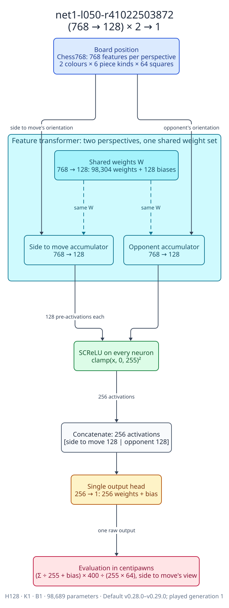</a><br>
      <sub><code>net1-l050-r41022503872</code><br>(768 → 128) × 2 → 1 · retired<br>
      <a href="diagrams/net1-l050-r41022503872.d2">source</a> · <a href="manifests/net1-l050-r41022503872.json">manifest</a> · <a href="../nets.md#net1-l050-r41022503872">ledger</a></sub>
    </td>
    <td align="center" valign="top" width="33%">
      <a href="diagrams/net2-l050-r41110004652.svg">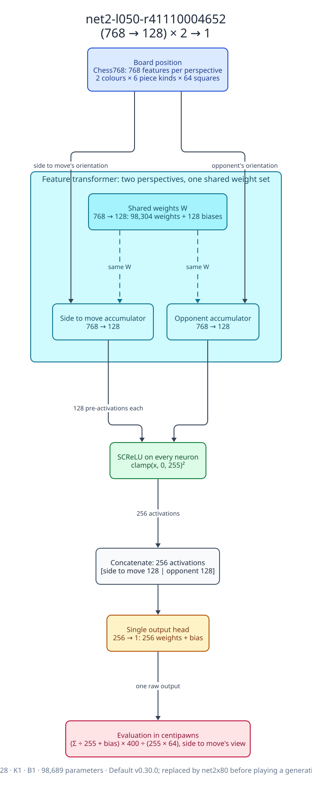</a><br>
      <sub><code>net2-l050-r41110004652</code><br>(768 → 128) × 2 → 1 · superseded<br>
      <a href="diagrams/net2-l050-r41110004652.d2">source</a> · <a href="manifests/net2-l050-r41110004652.json">manifest</a> · <a href="../nets.md#net2-l050-r41110004652">ledger</a></sub>
    </td>
    <td align="center" valign="top" width="33%">
      <a href="diagrams/net2x80-l050-r41131366975.svg">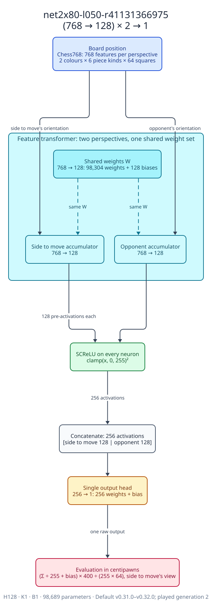</a><br>
      <sub><code>net2x80-l050-r41131366975</code><br>(768 → 128) × 2 → 1 · retired<br>
      <a href="diagrams/net2x80-l050-r41131366975.d2">source</a> · <a href="manifests/net2x80-l050-r41131366975.json">manifest</a> · <a href="../nets.md#net2x80-l050-r41131366975">ledger</a></sub>
    </td>
  </tr>
  <tr>
    <td align="center" valign="top" width="33%">
      <a href="diagrams/net2x80-l025-r41141703294.svg">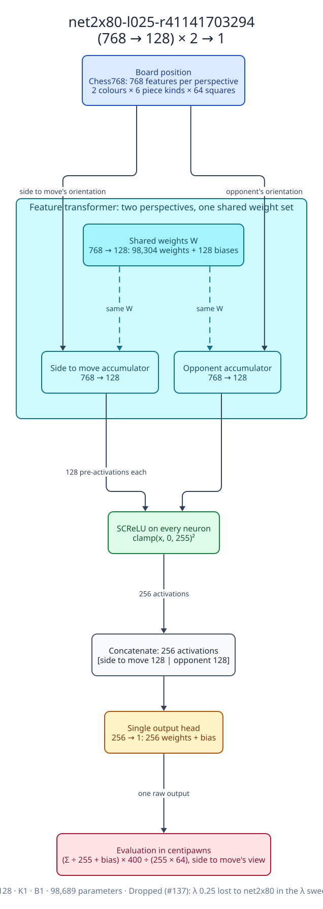</a><br>
      <sub><code>net2x80-l025-r41141703294</code><br>(768 → 128) × 2 → 1 · dropped<br>
      <a href="diagrams/net2x80-l025-r41141703294.d2">source</a> · <a href="manifests/net2x80-l025-r41141703294.json">manifest</a> · <a href="../nets.md#the-λ-sweep-net2x80-at-λ-025-and-075">ledger</a></sub>
    </td>
    <td align="center" valign="top" width="33%">
      <a href="diagrams/net2x80-l075-r41145466004.svg">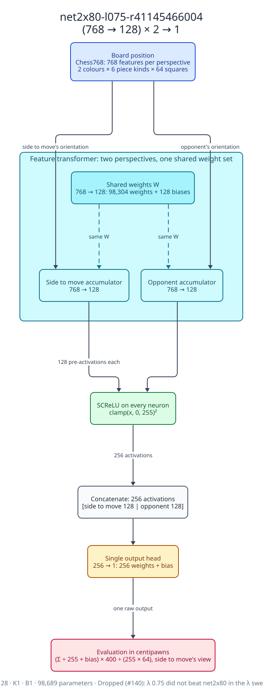</a><br>
      <sub><code>net2x80-l075-r41145466004</code><br>(768 → 128) × 2 → 1 · dropped<br>
      <a href="diagrams/net2x80-l075-r41145466004.d2">source</a> · <a href="manifests/net2x80-l075-r41145466004.json">manifest</a> · <a href="../nets.md#the-λ-sweep-net2x80-at-λ-025-and-075">ledger</a></sub>
    </td>
    <td align="center" valign="top" width="33%">
      <a href="diagrams/net3-l050-r41160495666.svg">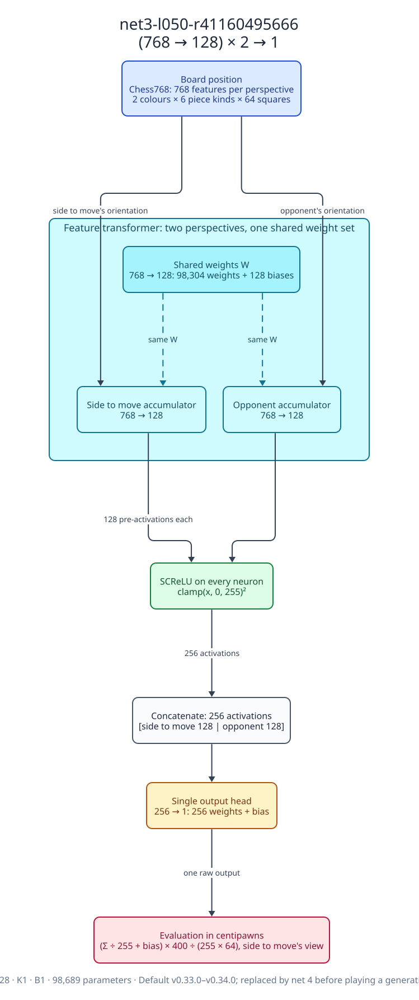</a><br>
      <sub><code>net3-l050-r41160495666</code><br>(768 → 128) × 2 → 1 · superseded<br>
      <a href="diagrams/net3-l050-r41160495666.d2">source</a> · <a href="manifests/net3-l050-r41160495666.json">manifest</a> · <a href="../nets.md#net3-l050-r41160495666">ledger</a></sub>
    </td>
  </tr>
  <tr>
    <td align="center" valign="top" width="33%">
      <a href="diagrams/net4-l050-r41165115607.svg">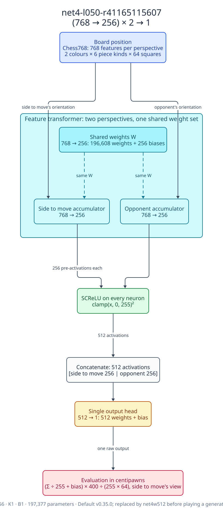</a><br>
      <sub><code>net4-l050-r41165115607</code><br>(768 → 256) × 2 → 1 · superseded<br>
      <a href="diagrams/net4-l050-r41165115607.d2">source</a> · <a href="manifests/net4-l050-r41165115607.json">manifest</a> · <a href="../nets.md#net4-l050-r41165115607">ledger</a></sub>
    </td>
    <td align="center" valign="top" width="33%">
      <a href="diagrams/net4w512-l050-r41170687764.svg">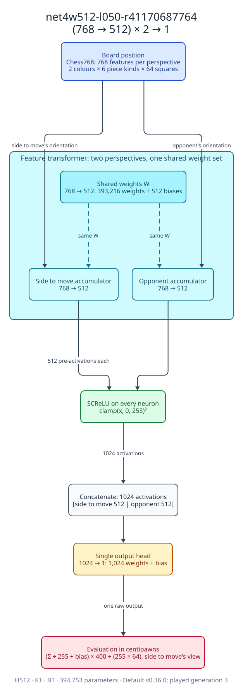</a><br>
      <sub><code>net4w512-l050-r41170687764</code><br>(768 → 512) × 2 → 1 · retired<br>
      <a href="diagrams/net4w512-l050-r41170687764.d2">source</a> · <a href="manifests/net4w512-l050-r41170687764.json">manifest</a> · <a href="../nets.md#net4w512-l050-r41170687764">ledger</a></sub>
    </td>
    <td align="center" valign="top" width="33%">
      <a href="diagrams/net5-l050-r41229287546.svg">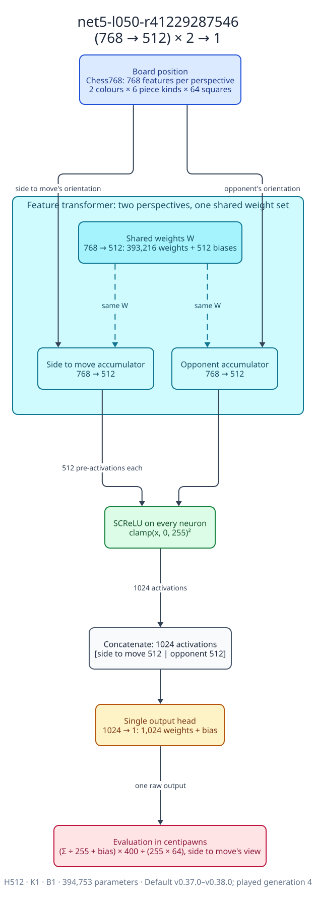</a><br>
      <sub><code>net5-l050-r41229287546</code><br>(768 → 512) × 2 → 1 · retired<br>
      <a href="diagrams/net5-l050-r41229287546.d2">source</a> · <a href="manifests/net5-l050-r41229287546.json">manifest</a> · <a href="../nets.md#net5-l050-r41229287546">ledger</a></sub>
    </td>
  </tr>
  <tr>
    <td align="center" valign="top" width="33%">
      <a href="diagrams/net5x120-l050-r41237487627.svg">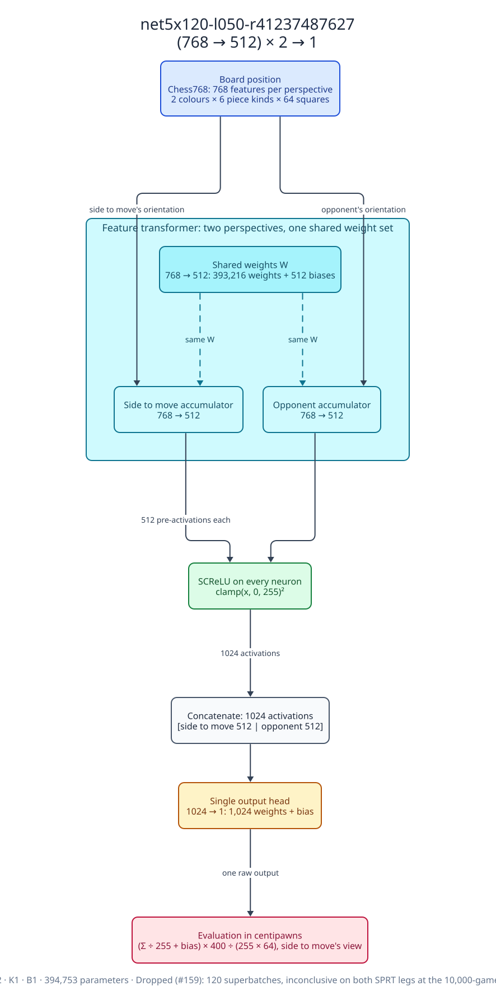</a><br>
      <sub><code>net5x120-l050-r41237487627</code><br>(768 → 512) × 2 → 1 · dropped<br>
      <a href="diagrams/net5x120-l050-r41237487627.d2">source</a> · <a href="manifests/net5x120-l050-r41237487627.json">manifest</a> · <a href="../nets.md#net5x120-l050-r41237487627">ledger</a></sub>
    </td>
    <td align="center" valign="top" width="33%">
      <a href="diagrams/net5b8-l050-r41265636815.svg">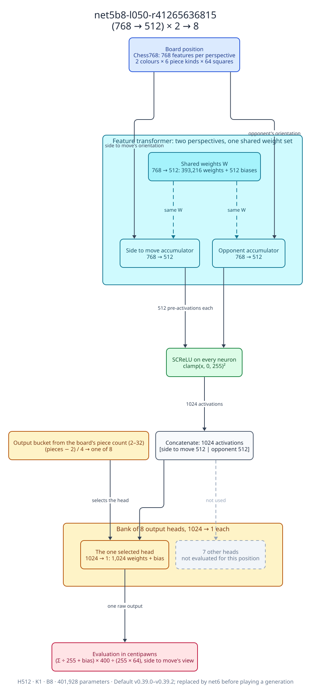</a><br>
      <sub><code>net5b8-l050-r41265636815</code><br>(768 → 512) × 2 → 8 · superseded<br>
      <a href="diagrams/net5b8-l050-r41265636815.d2">source</a> · <a href="manifests/net5b8-l050-r41265636815.json">manifest</a> · <a href="../nets.md#net5b8-l050-r41265636815">ledger</a></sub>
    </td>
    <td align="center" valign="top" width="33%">
      <a href="diagrams/net6-l050-r41273387683.svg">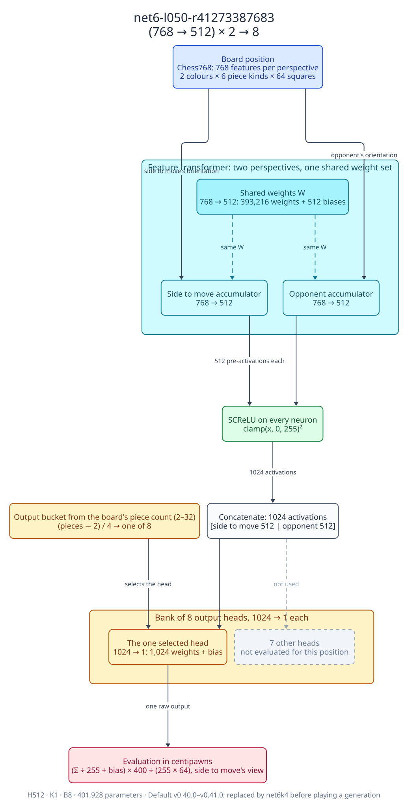</a><br>
      <sub><code>net6-l050-r41273387683</code><br>(768 → 512) × 2 → 8 · superseded<br>
      <a href="diagrams/net6-l050-r41273387683.d2">source</a> · <a href="manifests/net6-l050-r41273387683.json">manifest</a> · <a href="../nets.md#net6-l050-r41273387683">ledger</a></sub>
    </td>
  </tr>
  <tr>
    <td align="center" valign="top" width="33%">
      <a href="diagrams/net6k4-l050-r41282883885.svg">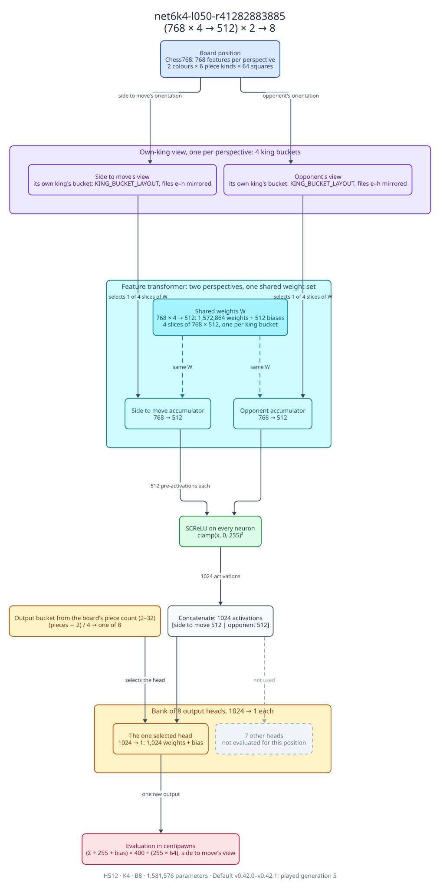</a><br>
      <sub><code>net6k4-l050-r41282883885</code><br>(768 × 4 → 512) × 2 → 8 · retired<br>
      <a href="diagrams/net6k4-l050-r41282883885.d2">source</a> · <a href="manifests/net6k4-l050-r41282883885.json">manifest</a> · <a href="../nets.md#net6k4-l050-r41282883885">ledger</a></sub>
    </td>
    <td align="center" valign="top" width="33%">
      <a href="diagrams/net7-l050-r41363264869.svg"></a><br>
      <sub><code>net7-l050-r41363264869</code><br>(768 × 4 → 512) × 2 → 8 · superseded<br>
      <a href="diagrams/net7-l050-r41363264869.d2">source</a> · <a href="manifests/net7-l050-r41363264869.json">manifest</a> · <a href="../nets.md#net7-l050-r41363264869">ledger</a></sub>
    </td>
    <td align="center" valign="top" width="33%">
      <a href="diagrams/net7rl012-l050-r42054816508.svg">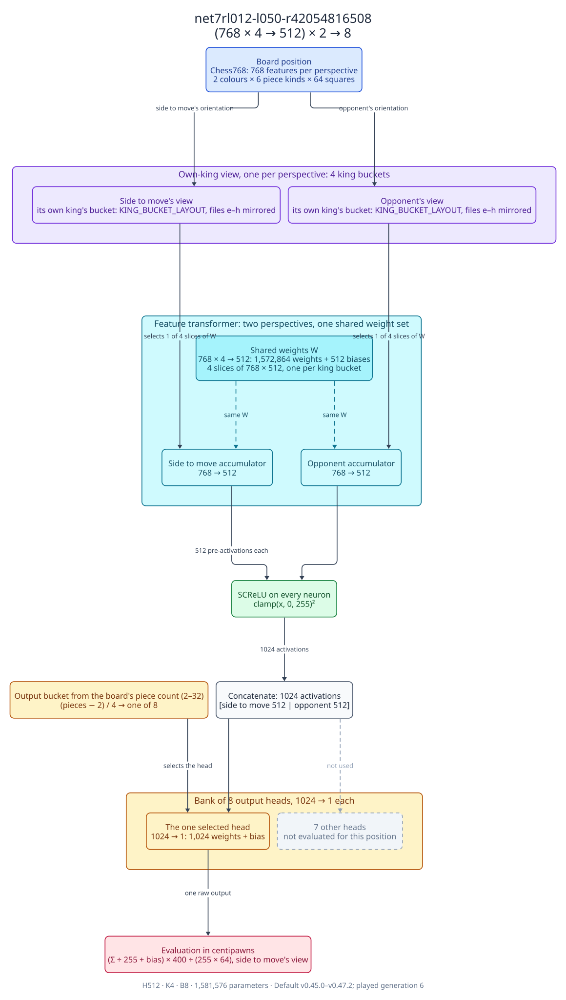</a><br>
      <sub><code>net7rl012-l050-r42054816508</code><br>(768 × 4 → 512) × 2 → 8 · retired<br>
      <a href="diagrams/net7rl012-l050-r42054816508.d2">source</a> · <a href="manifests/net7rl012-l050-r42054816508.json">manifest</a> · <a href="../nets.md#net7rl012-l050-r42054816508">ledger</a></sub>
    </td>
  </tr>
  <tr>
    <td align="center" valign="top" width="33%">
      <a href="diagrams/net7rl012345-l050-r42398995769.svg">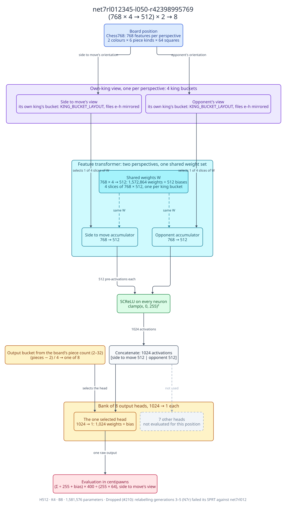</a><br>
      <sub><code>net7rl012345-l050-r42398995769</code><br>(768 × 4 → 512) × 2 → 8 · dropped<br>
      <a href="diagrams/net7rl012345-l050-r42398995769.d2">source</a> · <a href="manifests/net7rl012345-l050-r42398995769.json">manifest</a> · <a href="../nets.md#net7rl012345-l050-r42398995769">ledger</a></sub>
    </td>
    <td align="center" valign="top" width="33%">
      <a href="diagrams/net7rl012w768-l050-r42411319602.svg"></a><br>
      <sub><code>net7rl012w768-l050-r42411319602</code><br>(768 × 4 → 768) × 2 → 8 · dropped<br>
      <a href="diagrams/net7rl012w768-l050-r42411319602.d2">source</a> · <a href="manifests/net7rl012w768-l050-r42411319602.json">manifest</a> · <a href="../nets.md#net7rl012w768-l050-r42411319602">ledger</a></sub>
    </td>
    <td align="center" valign="top" width="33%">
      <a href="diagrams/net8-l050-r42564788061.svg"></a><br>
      <sub><code>net8-l050-r42564788061</code><br>(768 × 4 → 512) × 2 → 8 · default<br>
      <a href="diagrams/net8-l050-r42564788061.d2">source</a> · <a href="manifests/net8-l050-r42564788061.json">manifest</a> · <a href="../nets.md#net8-l050-r42564788061">ledger</a></sub>
    </td>
  </tr>
</table>
<!-- nnue-diagrams:gallery:end -->

## Adding a net

1. Record the net in [nets.md](../nets.md) first: a Summary row and a
   section, as [Adding a net](../nets.md#adding-a-net) says. The check
   requires every net in the Summary table to have a snapshot, and every
   snapshot to be in the table.
2. Copy the manifest of the net it changes from into
   `manifests/<full net id>.json` and edit it: the topology (from its
   `training.json`'s `hidden`, `output_buckets` and `king_buckets`, or the
   ledger's Network row), `file_bytes` (the size of `net.nnue`, which the
   check derives from the topology), the status, the change from the
   previous net, the experiment's PR and both SPRT legs, and the
   provenance. Leave what you don't know `null` rather than guessing;
   the required fields fail loudly if they're missing.
3. Run one command and commit everything it writes:

   ```sh
   npm run nnue:diagrams            # all nets; or: npm run nnue:diagrams -- --net <full net id>
   npm run nnue:diagrams:check      # what CI runs: fails on anything stale or inconsistent
   npm run nnue:diagrams:list       # the snapshots, in order
   ```

The generator lives in [`tools/nnue-diagrams/`](../../tools/nnue-diagrams/README.md).
It writes `diagrams/<net id>.d2` from the manifest and renders
`diagrams/<net id>.svg` with the D2 build `package.json` pins
(`@terrastruct/d2`, D2's WebAssembly build: `npm ci` installs it, and no
binary, Docker, GPU, AWS or S3 access is involved), then refreshes the
generated blocks of this page and of `evolution.md`. Rendering is
deterministic: running it twice leaves no diff, and CI's check renders
everything again and compares it byte for byte with what is committed.
